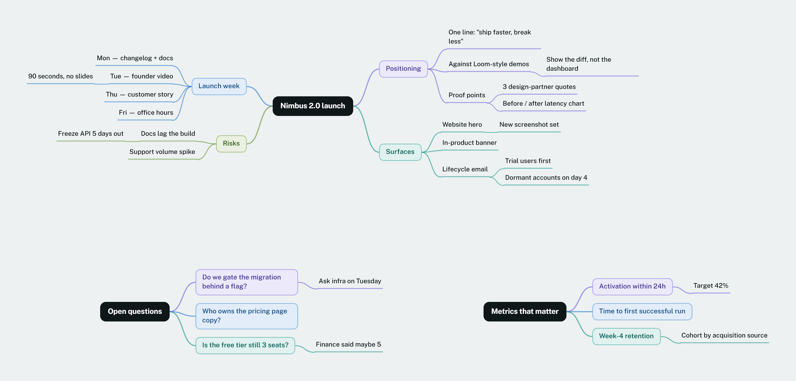

# Branchboard

Mind maps on a canvas, kept as plain files on your own computer.

Plant as many trees as you like on one board and grow each one as deep as the
idea goes. No account, no cloud, no sign-up. Every board is a `.json` file in a
folder you can see, copy, back up and read.



---

## Two ways to run it

**1. With the launcher — boards become real files**

```
Start Branchboard.bat
```

A small console window opens and your browser follows. Every board is saved as
its own `.json` file in the `boards/` folder next to the app. Keep the console
window open while you work.

Needs [Node.js](https://nodejs.org). No `npm install` required for this part —
the launcher uses nothing but Node's own standard library.

**2. Open `Branchboard.html` directly**

Double-click it. Works with nothing installed at all, but boards live in the
browser's storage instead of as files. That is a browser rule, not a choice: a
page opened from your disk is not allowed to write into folders. Use **Export**
now and then to keep a copy.

The app shows you which mode you are in — a green dot beside "Your boards" means
it is writing files, grey means browser storage.

On macOS and Linux there is no `.bat`; run `node server.js` in the folder.

---

## What it does

**Structure**

- Folders to file boards away, nested as deep as you like. Under the launcher
  these are real folders inside `boards/`, so a folder you make in the app
  appears in Explorer and one you make in Explorer appears in the app
- Many independent trees on one board, each to any depth
- Branches fan right, left, or both ways from the trunk
- Collapse any branch; it shows a count of what is hidden
- Drag a branch anywhere — past a box's outer edge makes it a child, above or
  below the middle slots it in as a sibling, and an amber line shows you which.
  Drop it well clear of everything and it becomes a tree of its own.
- Eight branch colours, inherited down each branch
- Bold, italic and underline inside the words, and emoji anywhere in the text
- An emoji and a link pinned to any box, plus a longer note that stays off the canvas

**Getting things in**

- **A picture of a mind map.** A photo or a screenshot. Claude reads it into an
  outline, you check the outline, then it becomes a board. Needs an API key —
  see below.
- **An outline.** Paste indented text from anywhere. Indentation is the
  structure; a line at the far left starts a new tree. Bullets, numbering and
  Markdown `#` headings are understood and stripped.
- **A board file.** Any `.json` exported from Branchboard.

**Getting things out**

PNG image, Markdown outline, or JSON that imports straight back.

---

## Keyboard

Built to be driven from the keys. Press `?` inside a board for the full list.
The mind-map shortcuts follow Whimsical's, so muscle memory carries over.

| | |
|---|---|
| `Tab` | add a child |
| `Enter` | add a sibling |
| `Ctrl + Enter` | add a sibling above |
| `Alt + Enter` | slot a new parent in above |
| `Ctrl + Alt + ]` / `[` | indent / outdent |
| `M` | new tree |
| `C` or `Ctrl + /` | collapse or expand |
| `Ctrl + C` / `X` / `V` | copy, cut, paste a branch |
| `Ctrl + F` | find in this board |
| `Shift + 1`…`8` | colour the branch |
| `Ctrl + B` / `I` / `U` | bold, italic, underline the selected words |
| `Ctrl + E` | drop an emoji into the words |
| `Shift + X` | pin an emoji to the front of a box |
| `= - 0 1 2` | zoom in, out, 100%, fit, fit selection |
| `Space + drag` | move the canvas |

Styling is stored as Markdown inside the text itself — `**bold**`, `*italic*`,
`<u>underline</u>` — so the saved `.json` still reads as words, the Markdown
export needs no conversion, and an outline round-trips unchanged. A style bar
appears over a box while you type in it.

Copy and paste are worth knowing. Copying a branch puts it on the clipboard as
plain indented text, so it pastes into any other app. Pasting an indented list
onto a selected box grows the whole sub-tree underneath it.

---

## Reading pictures of mind maps

This one feature talks to the internet. Everything else is local.

1. Get a key at [console.anthropic.com](https://console.anthropic.com)
2. Put it in a file called `apikey.txt` in this folder, on its own, nothing else
3. `npm install` in this folder, to fetch the Anthropic library
4. Restart the launcher

The key is read by `server.js` on your machine and sent only to Anthropic. It
never reaches the browser. `apikey.txt` is in `.gitignore`.

This is the Anthropic **API**, billed separately from any Claude.ai
subscription — a Pro or Max plan does not include it. Roughly 3–8 US cents per
picture.

Without a key everything else still works, and the picture screen hands you a
message you can paste into a normal Claude chat alongside your image; paste the
reply into the **From an outline** tab.

---

## What is in here

| | |
|---|---|
| `Branchboard.html` | the whole app — layout, styling and code in one file |
| `Start Branchboard.bat` | the Windows launcher |
| `server.js` | reads and writes the board files, and talks to Claude for picture import. Binds to `127.0.0.1` only, so no other machine can reach it |
| `boards/` | your mind maps, one `.json` each, inside whatever folders you make. Not in this repository |
| `boards/_deleted/` | deleted boards land here with a date stamp |

`boards/` is deliberately ignored by git. It is where your own thinking lives.

---

## Moving it, backing it up

The folder has no fixed path — put it anywhere. To back up, copy `boards/`. To
move one board to another machine, copy its `.json` into that machine's
`boards/` folder, or use **Import**.

---

## Notes

- The typefaces load from Google Fonts. Offline it falls back to your system
  font and everything still works.
- Tested in Chromium-based browsers. It uses `color-mix()` and `Range` APIs that
  want a reasonably recent browser.
- There is no collaboration, no comments and no sharing, on purpose. Adding them
  would mean a server and accounts, which would undo the thing that makes this
  useful: your files, your machine.

---

## Licence

MIT — see [LICENSE](LICENSE).
